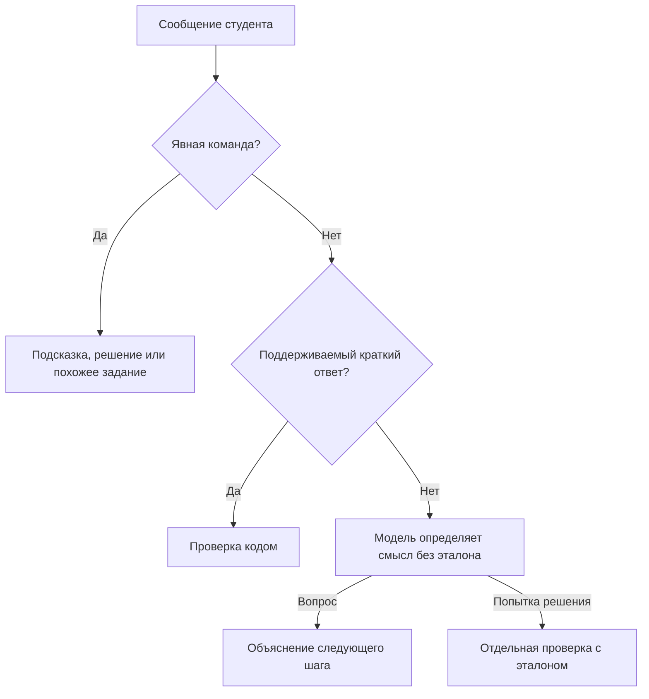

# Как объяснить проект на защите

## Что разработано

«Экзамен+» — учебный сайт: студент выбирает тему, получает задания, отправляет свои ответы и обсуждает непонятные шаги с ассистентом. В проекте подключается готовая языковая модель. Собственная нейросеть не обучалась.

## Из каких частей состоит

| Часть | Что делает | Где находится |
| --- | --- | --- |
| Страница | Показывает настройки, задания, чат и результаты | `dist/index.html`, `styles.css`, `app.mjs` |
| Сервер | Принимает запросы браузера и связывает остальные части | `server.mjs` |
| Подключение ИИ | Выбирает Gemini/Qwen, отправляет промпт, разбирает JSON или поток | `server/provider.mjs` |
| Хранилище | Временно хранит задания, эталоны, переписку и прогресс | `server/store.mjs` |
| Проверка кодом | Сравнивает поддерживаемые краткие ответы | `server/checker.mjs` |
| Промпты | Задают правила генерации, проверки и объяснения | `prompts/` |

Отдельной сборки и npm-зависимостей нет. Для сайта нужен Node.js; Python используется только в тестах заранее подготовленных учебных примеров.

## Как проходит сообщение

Развёрнутый ответ может потребовать двух обращений к модели: понять намерение, затем проверить работу. Это объясняет часть ожидания. Обычный вопрос не получает эталон из серверного хранилища.

## Почему нужна проверка кодом

Записи `1/2` и `0,5` обозначают одно значение. Аналогично, `200 см` и `2 м` равны после перевода единиц. Программа разбирает допустимые математические операции и сравнивает значения. Текстовый ответ и доказательство оценивает модель. Введённый код не исполняется, функция eval не используется.

У программной проверки тоже есть границы: таблица единиц ограничена длиной, массой, временем и скоростью; округление по умолчанию не считается точным равенством. По неизвестным единицам, рассуждениям и составным заданиям нужна модель.

## Почему ответы хранятся на сервере

Если спрятать ответ только оформлением страницы, его можно найти в данных браузера. Поэтому обычная генерация и история возвращают условия, собственные сообщения студента, безопасные объяснения и прогресс. Эталон возвращается по явному запросу решения. Сессия браузера отделяет его задания от чужих.

## Что показать преподавателю

Создать задания, отправить неправильный ответ и исправление, показать равнозначную запись, задать вопрос, запросить подсказку и отдельно решение. Затем открыть свою тему и историю. Показать тесты через `npm test`, пояснив, что автоматические API-проверки используют заглушки.

Настоящие проверки моделей и ограничения записаны в [EXPERIMENTS.md](EXPERIMENTS.md). Успешный пример не является статистикой точности по всем предметам. Модель может ошибаться, провайдер может быть временно недоступен.

## Ограничения и развитие

История находится в памяти одного процесса и очищается при перезапуске. Нет аккаунтов, постоянной базы и синхронизации устройств. Ограничения запросов учебной версии не заменяют общий контроль расходов на открытом массовом сайте. Дальнейшее развитие — база данных, авторизация, проверенные наборы заданий и измерение качества на размеченных примерах.
